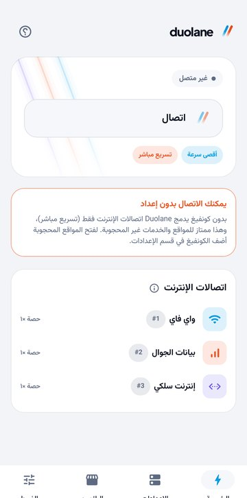
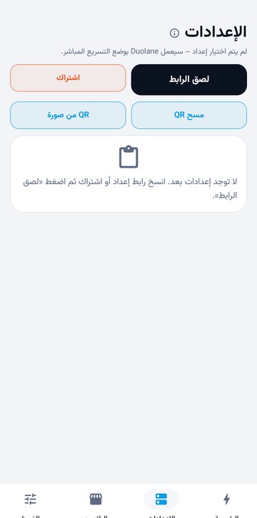
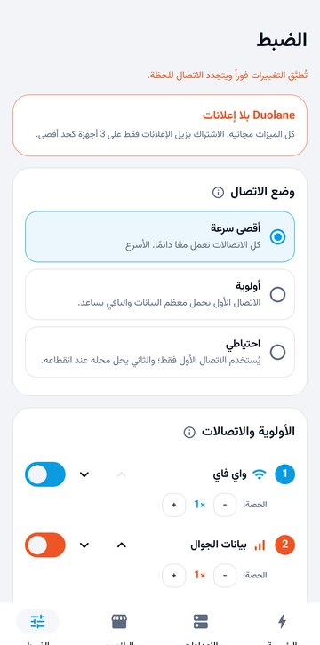
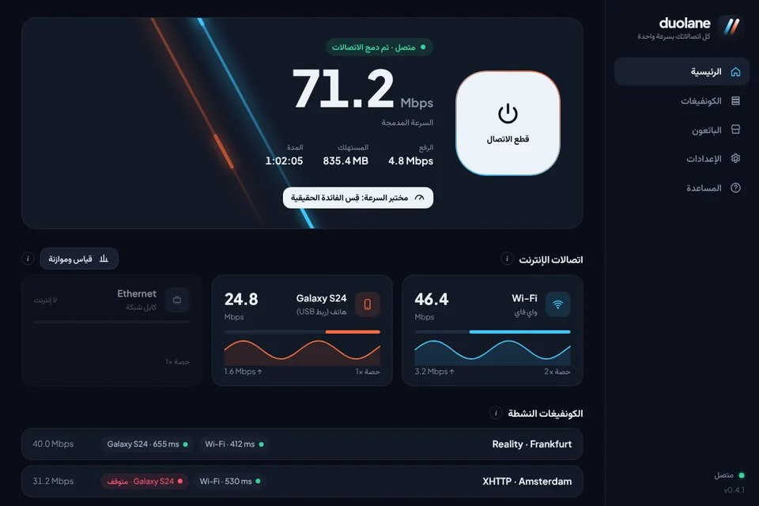

  

<h1 align="center">Duolane | إنترنت أسرع بدمج الواي فاي وبيانات الجوال</h1>

  <b>استخدم الواي فاي وبيانات الجوال في الوقت نفسه لإنترنت أسرع وأكثر ثباتاً، دون الحاجة إلى أي كونفيغ.</b> 
  مجاني لأندرويد وويندوز. وإذا كان لديك كونفيغ V2Ray فإنه يعمل على كل اتصالاتك معاً.

  
  
  

  <a href="README.md">English</a> · <a href="README.fa.md">فارسی</a> · <b>العربية</b> · <a href="README.tr.md">Türkçe</a> · <a href="README.id.md">Bahasa Indonesia</a> · <a href="README.vi.md">Tiếng Việt</a>

## ماذا يفعل Duolane؟

يستخدم هاتفك عادةً إنترنت واحداً في كل لحظة: الواي فاي أو بيانات الجوال، وليس الاثنين معاً. أما Duolane فيستخدمهما معاً. كل تطبيق يفتح اتصالات كثيرة في الوقت نفسه، فيرسل Duolane بعضها عبر الواي فاي والباقي عبر بيانات الجوال، فتُحمَّل الصفحات والتنزيلات والفيديوهات بسرعة الاثنين. وإذا انقطع أحدهما يبقيك الآخر متصلاً.

وعلى ويندوز يفعل الشيء نفسه مع كل اتصالات الكمبيوتر: الواي فاي، وكابل الشبكة، والهاتف عبر ربط USB، ومحوّل واي فاي USB إضافي.

هناك طريقتان للاستخدام:

| | بدون كونفيغ (تسريع مباشر) | مع كونفيغات V2Ray |
|---|---|---|
| ما تحتاجه | لا شيء؛ ثبّت التطبيق واضغط «اتصال» | كونفيغ VLESS أو VMess أو Trojan أو Shadowsocks أو Hysteria2، أو رابط اشتراك |
| أين تذهب البيانات | مباشرةً إلى الإنترنت دون المرور بأي خادم | عبر كونفيغاتك، موزعةً على كل الاتصالات |
| مناسب لـ | تنزيلات وفيديو وتحديثات أسرع، وبقاء الاتصال عند انقطاع الواي فاي | فتح المواقع المحجوبة بعدة كونفيغات معاً، مع استبعاد الكونفيغ المعطّل تلقائياً |

## التحميل

| النظام | الملف | ملاحظة |
|---|---|---|
| أندرويد 7.0 وأحدث | [Duolane-arm64.apk](https://github.com/duolaneapp/duolane-app/releases/latest/download/Duolane-arm64.apk) | معظم هواتف آخر 6 سنوات |
| | [Duolane-universal.apk](https://github.com/duolaneapp/duolane-app/releases/latest/download/Duolane-universal.apk) | غير متأكد؟ اختر هذا |
| | [Duolane-arm32.apk](https://github.com/duolaneapp/duolane-app/releases/latest/download/Duolane-arm32.apk) | الهواتف الأقدم |
| ويندوز 10 و11 (64 بت) | [Duolane-Setup.exe](https://github.com/duolaneapp/duolane-app/releases/latest/download/Duolane-Setup.exe) | برنامج تثبيت مع خدمة تعمل في الخلفية |

كل الإصدارات وتغييراتها في [صفحة الإصدارات](https://github.com/duolaneapp/duolane-app/releases). لا حاجة إلى حساب أو تسجيل، والتحديثات تظهر داخل التطبيق.

## لقطات الشاشة

  
  
  

## المزايا

- **دمج الاتصالات:** الواي فاي وبيانات الجوال على أندرويد؛ والواي فاي والكابل وربط USB ومحوّلات الواي فاي USB على ويندوز.
- **ثلاثة أوضاع:** أقصى سرعة (كل الاتصالات معاً)، والأولوية (الاتصال الأول يحمل نحو 3 أضعاف الباقي)، والاحتياطي (ينتقل فقط عند انقطاع الاتصال الرئيسي).
- **عدة كونفيغات معاً:** كل كونفيغ يعمل على كل الاتصالات. تُفحص الكونفيغات كل دقيقة تقريباً، والكونفيغ الذي لا يستجيب يُستبعد بضع دقائق تلقائياً.
- **استيراد أي صيغة تقريباً:** روابط vless وvmess وtrojan وss وhysteria2، وروابط الاشتراك، وClash/Mihomo وsing-box ورموز QR.
- **مغيّر DNS مدمج:** Cloudflare أو Google أو Quad9 أو AdGuard أو خوادمك الخاصة، لكل التطبيقات وحتى بدون كونفيغ، ولا يستطيع DNS المشفّر في النظام تجاوزه.
- **مواقع وتطبيقات بدون كونفيغ:** اختر مواقع وتطبيقات تُفتح مباشرةً بينما يمر الباقي عبر كونفيغاتك.
- **مختبر السرعة:** يقيس كل اتصال وحده ثم كل الاتصالات معاً، لترى الفائدة الحقيقية على خطوطك.
- **منع التسريب:** يبقى DNS وIPv6 داخل النفق طوال الاتصال.
- **ست لغات:** العربية وEnglish وTürkçe وBahasa Indonesia وTiếng Việt وفارسی.

## ماذا تتوقع من السرعة؟

الدمج لا يضاعف السرعة بالضبط، ولا يخفض البنغ. أكبر فائدة تظهر في التنزيلات والفيديو ومتاجر التطبيقات والصفحات الثقيلة لأنها تفتح اتصالات كثيرة معاً. أما تنزيل ملف واحد من المتصفح أو المكالمة أو اللعبة عبر الإنترنت فيستخدم اتصالاً واحداً، فلا يصبح أسرع، لكنه لا ينقطع إذا انقطع أحد الاتصالات. ويعرض لك مختبر السرعة داخل التطبيق الرقم الحقيقي لاتصالاتك.

## البدء

1. ثبّت Duolane واترك الواي فاي وبيانات الجوال مفعّلين معاً (على ويندوز وصّل الكابل أو ربط USB أيضاً).
2. اضغط «اتصال». هذا كل ما يلزم للتسريع المباشر.
3. اختياري: انسخ رابط كونفيغ أو اشتراك، وافتح قسم «الكونفيغات» واضغط «لصق الرابط». حدد كونفيغين أو ثلاثة سريعة لتعمل معاً.

## الأسئلة الشائعة

<b>هل أحتاج إلى كونفيغ V2Ray؟</b>

لا. بدون كونفيغ يدمج Duolane اتصالاتك ويرسل البيانات مباشرةً إلى الإنترنت. تحتاج إلى كونفيغ فقط لفتح المواقع المحجوبة في بلدك.

<b>هل Duolane خدمة VPN؟</b>

لا. Duolane لا يبيع خوادم ولا كونفيغات. يستخدم ميزة VPN في أندرويد على الهاتف نفسه لتوجيه بياناتك عبر كل اتصالاتك، وعبر كونفيغاتك إن أضفتها.

<b>هل يستهلك بيانات جوال أكثر؟</b>

نعم، يذهب جزء من البيانات عبر الجوال عندما يكون الواي فاي مفعّلاً. استخدم وضع الأولوية أو الاحتياطي لإبقاء معظم البيانات على الواي فاي.

<b>هل يحتاج إلى صلاحيات الروت؟</b>

لا. على أندرويد يطلب إذن VPN العادي فقط، وعلى ويندوز يثبّت خدمة صغيرة تعمل في الخلفية.

<b>هل هو مجاني؟</b>

كل المزايا مجانية. يعرض التطبيق بعض الإعلانات، ويزيلها اشتراك اختياري على ما يصل إلى 3 أجهزة.

## الأمان

- حمّل فقط من هذه الصفحة أو من [duolaneapp.com](https://duolaneapp.com/ar/) أو من قنوات Duolane الرسمية.
- نسخ أندرويد موقّعة بمفتاح Duolane الرسمي. إذا رفض أندرويد تثبيت تحديث فوق نسخة مثبتة، فتلك النسخة لم تكن منّا.
- قد يعرض ويندوز تنبيه SmartScreen لملف جديد. اختر «More info» ثم «Run anyway».

## روابط

- الموقع والأدلة: [duolaneapp.com/ar](https://duolaneapp.com/ar/)
- الدعم: [duolaneapp.com/ar/support](https://duolaneapp.com/ar/support/)
- الخصوصية: [duolaneapp.com/ar/privacy](https://duolaneapp.com/ar/privacy/)

كلمات مفتاحية: تسريع الإنترنت، دمج الواي فاي وبيانات الجوال، استخدام الواي فاي والبيانات معاً، تقوية إنترنت الهاتف، عميل V2Ray لأندرويد وويندوز، Xray، كونفيغ VLESS، Hysteria2، رابط اشتراك، مغيّر DNS، تحميل مجاني.

