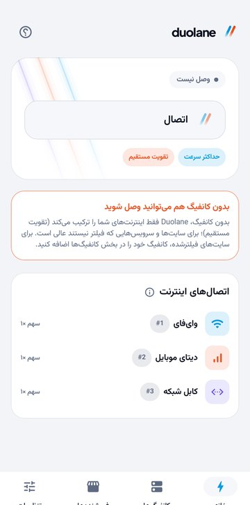
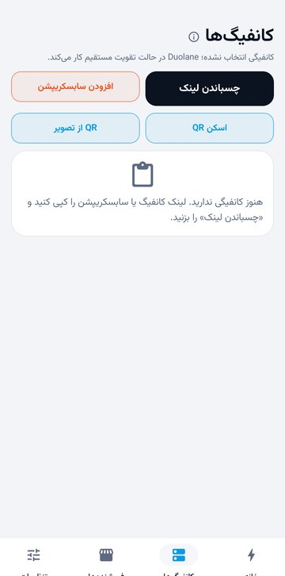
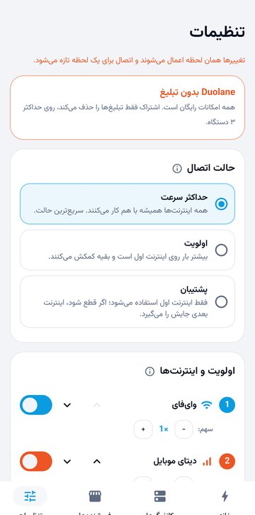
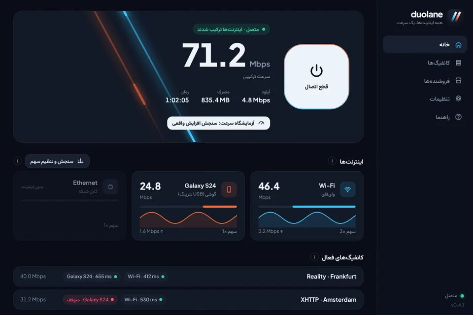

  

<h1 align="center">Duolane | افزایش سرعت اینترنت با وای‌فای و دیتای همزمان</h1>

  <b>وای‌فای و دیتای موبایل را هم‌زمان استفاده کنید؛ اینترنت سریع‌تر و پایدارتر، بدون نیاز به کانفیگ.</b> 
  رایگان برای اندروید و ویندوز. اگر کانفیگ V2Ray دارید، روی همه اینترنت‌هایتان با هم اجرا می‌شود.

  
  
  

  <a href="README.md">English</a> · <b>فارسی</b> · <a href="README.ar.md">العربية</a> · <a href="README.tr.md">Türkçe</a> · <a href="README.id.md">Bahasa Indonesia</a> · <a href="README.vi.md">Tiếng Việt</a>

## Duolane چه کار می‌کند؟

گوشی شما معمولاً هر لحظه فقط از یک اینترنت استفاده می‌کند: یا وای‌فای، یا دیتا؛ هیچ‌وقت هر دو. Duolane همه را با هم به کار می‌گیرد. هر برنامه هم‌زمان اتصال‌های زیادی باز می‌کند؛ Duolane بخشی از آن‌ها را از وای‌فای و بقیه را از دیتای موبایل می‌فرستد، پس صفحه‌ها، دانلودها و ویدیوها با سرعت هر دو اینترنت بار می‌شوند. اگر یکی از اینترنت‌ها قطع شود، بقیه شما را آنلاین نگه می‌دارند.

در ویندوز هم همین کار را با همه اتصال‌های کامپیوتر انجام می‌دهد: وای‌فای، کابل شبکه، گوشی با USB تترینگ یا یک کارت وای‌فای USB دوم.

دو راه برای استفاده هست:

| | بدون کانفیگ (تقویت مستقیم) | همراه کانفیگ V2Ray |
|---|---|---|
| چه لازم است | هیچ چیز؛ نصب کنید و «اتصال» را بزنید | کانفیگ VLESS، VMess، Trojan، Shadowsocks یا Hysteria2، یا لینک سابسکریپشن |
| ترافیک از کجا می‌رود | مستقیم به اینترنت، بدون عبور از هیچ سروری | از داخل کانفیگ‌های شما، پخش‌شده روی همه اینترنت‌ها |
| مناسب برای | دانلود و ویدیو و آپدیت سریع‌تر؛ قطع نشدن اینترنت وقتی وای‌فای می‌پرد | باز کردن سایت‌های فیلترشده، با چند کانفیگ هم‌زمان و کنار رفتن خودکار کانفیگ خراب |

## دانلود

| سیستم | فایل | توضیح |
|---|---|---|
| اندروید ۷ و بالاتر | [Duolane-arm64.apk](https://github.com/duolaneapp/duolane-app/releases/latest/download/Duolane-arm64.apk) | بیشتر گوشی‌های ۶ سال اخیر |
| | [Duolane-universal.apk](https://github.com/duolaneapp/duolane-app/releases/latest/download/Duolane-universal.apk) | مطمئن نیستید؟ همین را نصب کنید |
| | [Duolane-arm32.apk](https://github.com/duolaneapp/duolane-app/releases/latest/download/Duolane-arm32.apk) | گوشی‌های قدیمی‌تر |
| ویندوز ۱۰ و ۱۱ (۶۴ بیت) | [Duolane-Setup.exe](https://github.com/duolaneapp/duolane-app/releases/latest/download/Duolane-Setup.exe) | نصب‌کننده همراه سرویس پس‌زمینه |

همه نسخه‌ها و تغییراتشان در [صفحه Releases](https://github.com/duolaneapp/duolane-app/releases) است. حساب کاربری و ثبت‌نام لازم نیست و نسخه‌های جدید داخل خود برنامه اطلاع داده می‌شوند.

## تصویرها

  
  
  

## امکانات

- **ترکیب اینترنت‌ها:** وای‌فای و دیتای موبایل در اندروید؛ وای‌فای، کابل، USB تترینگ و کارت وای‌فای USB در ویندوز.
- **سه حالت اتصال:** حداکثر سرعت (همه با هم)، اولویت (اینترنت اول حدود ۳ برابر بیشتر بار می‌برد) و پشتیبان (فقط وقتی اینترنت اصلی قطع شود جایگزین می‌شود).
- **چند کانفیگ هم‌زمان:** هر کانفیگ روی همه اینترنت‌ها اجرا می‌شود. سلامت کانفیگ‌ها حدود هر دقیقه بررسی می‌شود و کانفیگی که جواب ندهد چند دقیقه خودکار کنار می‌رود.
- **وارد کردن هر نوع کانفیگ:** لینک‌های vless، vmess، trojan، ss و hysteria2، لینک سابسکریپشن، Clash/Mihomo، sing-box و کد QR.
- **DNS چنجر داخلی:** Cloudflare، Google، Quad9، AdGuard یا سرورهای دلخواه، برای همه برنامه‌ها و حتی بدون کانفیگ. DNS رمزنگاری‌شده سیستم هم نمی‌تواند دورش بزند.
- **سایت‌ها و برنامه‌های بدون کانفیگ:** سایت‌ها و برنامه‌هایی را انتخاب کنید که مستقیم باز شوند و بقیه از کانفیگ بروند.
- **آزمایشگاه سرعت:** هر اینترنت را جدا و بعد همه را با هم می‌سنجد تا افزایش واقعی را روی خط خودتان ببینید.
- **جلوگیری از نشت:** تا وقتی وصل هستید، DNS و IPv6 بیرون از تونل نمی‌روند.
- **شش زبان:** فارسی، English، العربية، Türkçe، Bahasa Indonesia و Tiếng Việt.

## از سرعت چه انتظاری داشته باشید؟

ترکیب، سرعت را دقیقاً دو برابر نمی‌کند و پینگ را هم کم نمی‌کند. بیشترین افزایش در دانلود، ویدیو، فروشگاه برنامه‌ها و صفحه‌های سنگین است، چون هم‌زمان اتصال‌های زیادی باز می‌کنند. دانلود یک فایل با دانلودر مرورگر، تماس صوتی یا بازی آنلاین از یک اتصال استفاده می‌کند؛ سریع‌تر نمی‌شود، ولی با قطع یک اینترنت قطع نمی‌شود. عدد واقعی خط شما را آزمایشگاه سرعت داخل برنامه نشان می‌دهد.

## شروع کار

1. Duolane را نصب کنید و وای‌فای و دیتای موبایل را هر دو روشن نگه دارید (در ویندوز کابل یا USB تترینگ را هم وصل کنید).
2. «اتصال» را بزنید. برای تقویت مستقیم همین کافی است.
3. اختیاری: لینک کانفیگ یا سابسکریپشن را کپی کنید، به بخش «کانفیگ‌ها» بروید و «چسباندن لینک» را بزنید. دو یا سه کانفیگ سریع را انتخاب کنید تا با هم کار کنند.

## سؤال‌های رایج

<b>برای استفاده حتماً کانفیگ لازم است؟</b>

نه. بدون کانفیگ، Duolane اینترنت‌های شما را ترکیب می‌کند و ترافیک مستقیم به اینترنت می‌رود. کانفیگ فقط برای باز کردن سایت‌های فیلترشده لازم است.

<b>Duolane فیلترشکن یا سرویس VPN است؟</b>

نه. Duolane سرور یا کانفیگ نمی‌فروشد. از قابلیت VPN خود اندروید روی همان گوشی استفاده می‌کند تا ترافیک را روی همه اینترنت‌هایتان، و اگر کانفیگ اضافه کنید از داخل کانفیگ‌های خودتان، بفرستد.

<b>حجم دیتای موبایل بیشتر مصرف می‌شود؟</b>

بله، وقتی وای‌فای هم روشن است بخشی از ترافیک از دیتا می‌رود. برای اینکه بیشتر ترافیک روی وای‌فای بماند، حالت «اولویت» یا «پشتیبان» را انتخاب کنید.

<b>دسترسی روت لازم دارد؟</b>

نه. در اندروید فقط اجازه معمولی VPN را می‌خواهد و در ویندوز یک سرویس پس‌زمینه کوچک نصب می‌کند.

<b>رایگان است؟</b>

همه امکانات رایگان است. برنامه چند تبلیغ نشان می‌دهد و اشتراک اختیاری، تبلیغ‌ها را روی حداکثر ۳ دستگاه حذف می‌کند.

## امنیت

- فقط از همین صفحه، از [duolaneapp.com](https://duolaneapp.com/fa/) یا از کانال‌های رسمی Duolane دانلود کنید.
- نسخه‌های اندروید با کلید رسمی Duolane امضا شده‌اند. اگر اندروید اجازه نصب آپدیت روی نسخه قبلی را نداد، آن نسخه از طرف ما نبوده است.
- ویندوز ممکن است برای فایل تازه‌دانلودشده هشدار SmartScreen نشان دهد. «More info» و بعد «Run anyway» را بزنید.

## لینک‌ها

- سایت و آموزش‌ها: [duolaneapp.com/fa](https://duolaneapp.com/fa/)
- پشتیبانی: [duolaneapp.com/fa/support](https://duolaneapp.com/fa/support/)
- حریم خصوصی: [duolaneapp.com/fa/privacy](https://duolaneapp.com/fa/privacy/)

کلمات کلیدی: افزایش سرعت اینترنت، ترکیب وای‌فای و دیتا، استفاده هم‌زمان از وای‌فای و دیتای موبایل، تقویت اینترنت گوشی، کلاینت V2Ray برای اندروید و ویندوز، کانفیگ VLESS، Hysteria2، سابسکریپشن، DNS چنجر، دانلود رایگان.

