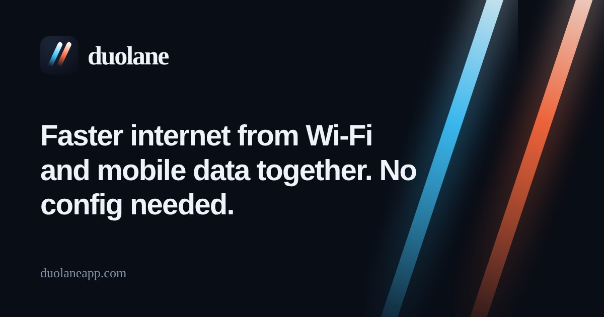
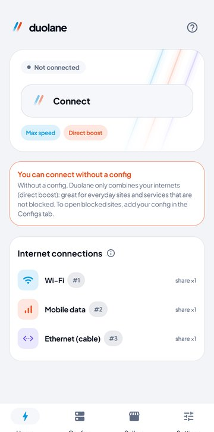
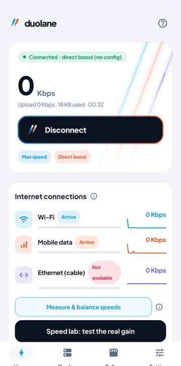
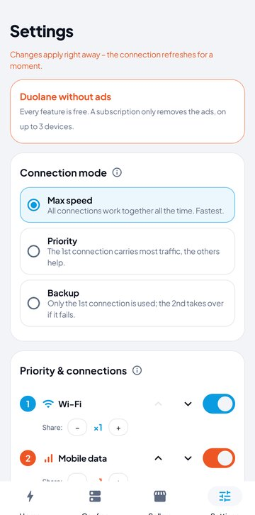
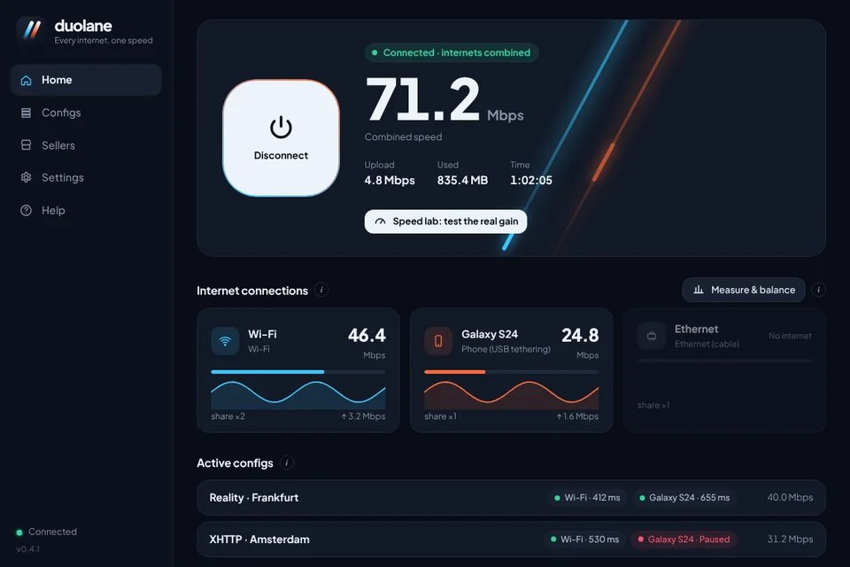

  

<h1 align="center">Duolane | Gabungkan Wi-Fi dan data seluler untuk internet lebih cepat</h1>

  <b>Pakai Wi-Fi dan data seluler sekaligus: internet lebih cepat dan lebih stabil, tanpa perlu config.</b> 
  Gratis untuk Android dan Windows. Kalau kamu punya config V2Ray, config itu berjalan di semua koneksimu sekaligus.

  
  
  

  <a href="README.md">English</a> · <a href="README.fa.md">فارسی</a> · <a href="README.ar.md">العربية</a> · <a href="README.tr.md">Türkçe</a> · <b>Bahasa Indonesia</b> · <a href="README.vi.md">Tiếng Việt</a>

## Apa yang dilakukan Duolane?

Biasanya ponselmu hanya memakai satu internet dalam satu waktu: Wi-Fi atau data seluler, tidak pernah keduanya. Duolane memakai keduanya bersamaan. Setiap aplikasi membuka banyak koneksi sekaligus; Duolane mengirim sebagian lewat Wi-Fi dan sisanya lewat data seluler, sehingga halaman, unduhan, dan video dimuat dengan kecepatan keduanya. Kalau salah satu putus, yang lain tetap membuatmu online.

Di Windows, hal yang sama berlaku untuk semua koneksi komputer: Wi-Fi, kabel LAN, ponsel lewat USB tethering, atau adaptor Wi-Fi USB kedua.

Ada dua cara memakainya:

| | Tanpa config (boost langsung) | Dengan config V2Ray |
|---|---|---|
| Yang dibutuhkan | Tidak ada; pasang lalu ketuk Hubungkan | Config VLESS, VMess, Trojan, Shadowsocks, atau Hysteria2, atau link langganan |
| Lalu lintas lewat mana | Langsung ke internet, tanpa melewati server apa pun | Lewat config-mu, dibagi ke semua koneksi |
| Cocok untuk | Unduhan, video, dan update lebih cepat; tetap online saat Wi-Fi putus | Membuka situs yang diblokir, dengan beberapa config sekaligus; config yang rusak disisihkan otomatis |

## Unduh

| Sistem | File | Catatan |
|---|---|---|
| Android 7.0 ke atas | [Duolane-arm64.apk](https://github.com/duolaneapp/duolane-app/releases/latest/download/Duolane-arm64.apk) | Sebagian besar ponsel 6 tahun terakhir |
| | [Duolane-universal.apk](https://github.com/duolaneapp/duolane-app/releases/latest/download/Duolane-universal.apk) | Tidak yakin? Pilih yang ini |
| | [Duolane-arm32.apk](https://github.com/duolaneapp/duolane-app/releases/latest/download/Duolane-arm32.apk) | Ponsel lama |
| Windows 10 / 11 (64-bit) | [Duolane-Setup.exe](https://github.com/duolaneapp/duolane-app/releases/latest/download/Duolane-Setup.exe) | Penginstal dengan layanan latar belakang |

Semua versi dan perubahannya ada di [halaman Releases](https://github.com/duolaneapp/duolane-app/releases). Tidak perlu akun atau pendaftaran, dan pembaruan muncul di dalam aplikasi.

> Catatan untuk pengguna di Indonesia: Android kini meminta verifikasi pengembang untuk aplikasi di luar Play Store. Jika muncul peringatan saat memasang, ikuti langkah lanjutan di layar untuk mengizinkan pemasangan.

## Tangkapan layar

  
  
  

## Fitur

- **Gabungkan koneksi internet:** Wi-Fi dan data seluler di Android; Wi-Fi, kabel, USB tethering, dan adaptor Wi-Fi USB di Windows.
- **Tiga mode:** Kecepatan maksimal (semua koneksi bersama), Prioritas (koneksi pertama membawa sekitar 3 kali lebih banyak), dan Cadangan (hanya beralih saat koneksi utama putus).
- **Beberapa config sekaligus:** Setiap config berjalan di semua koneksi. Kesehatannya dicek sekitar sekali per menit, dan config yang tidak merespons disisihkan beberapa menit secara otomatis.
- **Impor hampir semua format:** link vless, vmess, trojan, ss, dan hysteria2, link langganan, Clash/Mihomo, sing-box, dan kode QR.
- **Pengubah DNS bawaan:** Cloudflare, Google, Quad9, AdGuard, atau server pilihanmu, untuk semua aplikasi, bahkan tanpa config. DNS terenkripsi milik sistem tidak bisa melewatinya.
- **Situs dan aplikasi tanpa config:** Pilih situs dan aplikasi yang dibuka langsung, sementara sisanya lewat config-mu.
- **Lab kecepatan:** Mengukur setiap koneksi sendiri-sendiri lalu semuanya bersama, jadi kamu melihat peningkatan nyata di jaringanmu.
- **Perlindungan kebocoran:** DNS dan IPv6 tetap di dalam tunnel selama terhubung.
- **Enam bahasa:** Bahasa Indonesia, English, العربية, Türkçe, Tiếng Việt, dan فارسی.

## Seberapa cepat?

Penggabungan tidak membuat kecepatan tepat dua kali lipat, dan tidak menurunkan ping. Peningkatan terbesar terasa pada unduhan, video, toko aplikasi, dan halaman berat, karena semuanya membuka banyak koneksi sekaligus. Satu unduhan di browser, panggilan suara, atau game online memakai satu koneksi, jadi tidak lebih cepat, tetapi tidak putus saat salah satu internet putus. Lab kecepatan di aplikasi menunjukkan angka nyata untuk koneksimu.

## Mulai

1. Pasang Duolane dan nyalakan Wi-Fi serta data seluler bersamaan (di Windows, colokkan juga kabel atau USB tethering).
2. Ketuk **Hubungkan**. Untuk boost langsung, itu saja.
3. Opsional: salin link config atau langganan, buka **Config**, lalu ketuk **Tempel link**. Pilih dua atau tiga config cepat agar berjalan bersama.

## Pertanyaan umum

<b>Apakah saya perlu config V2Ray?</b>

Tidak. Tanpa config, Duolane menggabungkan koneksimu dan mengirim lalu lintas langsung ke internet. Config hanya perlu untuk membuka situs yang diblokir di tempatmu.

<b>Apakah Duolane layanan VPN?</b>

Tidak. Duolane tidak menjual server atau config. Duolane memakai fitur VPN bawaan Android di ponsel itu sendiri untuk mengarahkan lalu lintas lewat semua koneksimu, dan lewat config-mu sendiri jika kamu menambahkannya.

<b>Apakah kuota data seluler jadi lebih boros?</b>

Ya, saat Wi-Fi menyala sebagian lalu lintas lewat data seluler. Pakai mode Prioritas atau Cadangan agar sebagian besar lalu lintas tetap di Wi-Fi.

<b>Perlu root?</b>

Tidak. Di Android hanya butuh izin VPN biasa; di Windows memasang layanan latar belakang kecil.

<b>Gratis?</b>

Semua fitur gratis. Aplikasi menampilkan sedikit iklan; langganan opsional menghapusnya di hingga 3 perangkat.

## Keamanan

- Unduh hanya dari halaman ini, dari [duolaneapp.com](https://duolaneapp.com), atau dari kanal resmi Duolane.
- Versi Android ditandatangani dengan kunci resmi Duolane. Jika Android menolak memasang pembaruan di atas versi yang sudah terpasang, versi itu bukan dari kami.
- Windows mungkin menampilkan peringatan SmartScreen untuk file baru. Pilih **More info**, lalu **Run anyway**.

## Tautan

- Situs web dan panduan: [duolaneapp.com](https://duolaneapp.com)
- Dukungan: [duolaneapp.com/support](https://duolaneapp.com/support/)
- Privasi: [duolaneapp.com/privacy](https://duolaneapp.com/privacy/)

Kata kunci: penguat sinyal internet, gabungkan Wi-Fi dan data seluler, internet lebih cepat, dual internet, unduh lebih cepat, klien V2Ray, Xray, VLESS Reality, Hysteria2, link langganan, pengubah DNS, Android, Windows, gratis.
