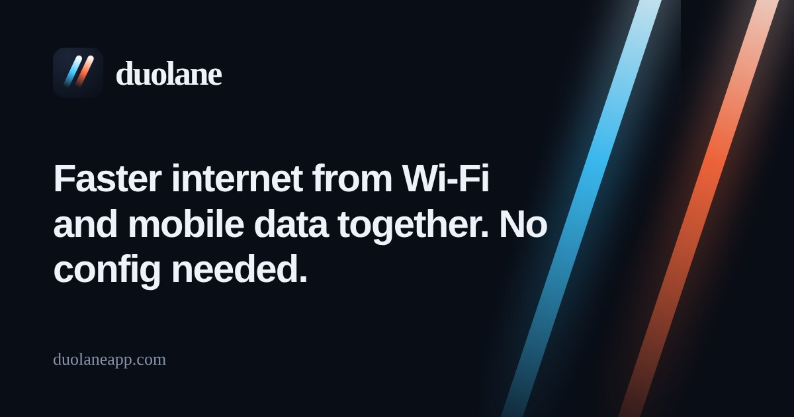
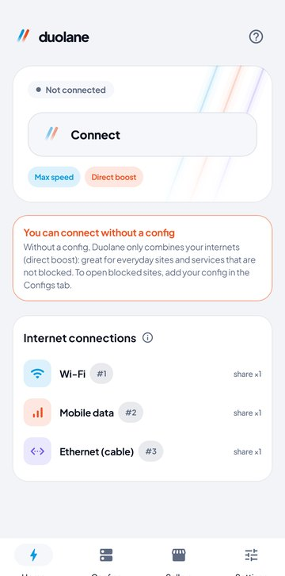
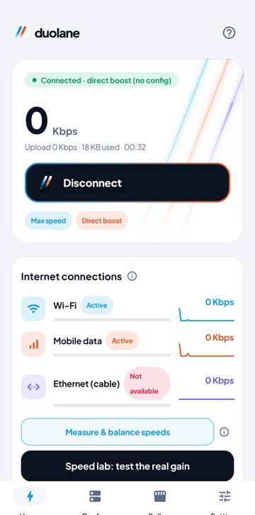
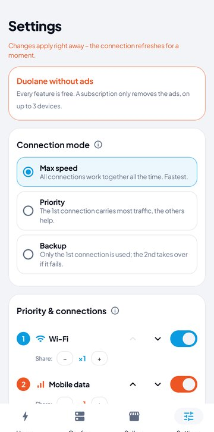
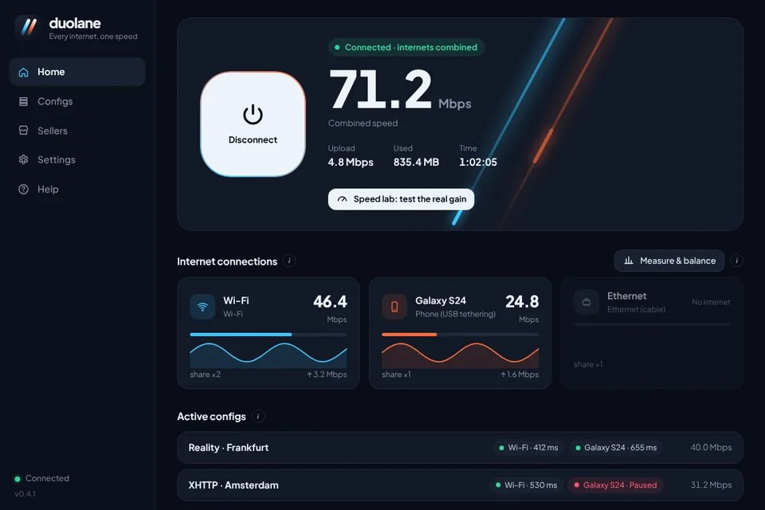

  

<h1 align="center">Duolane</h1>

  <b>Use Wi-Fi and mobile data at the same time for faster, steadier internet.</b> 
  Free for Android and Windows. Works without any config, and runs your V2Ray / Xray configs on every connection too.

  
  
  

  <b>English</b> · <a href="README.fa.md">فارسی</a> · <a href="README.ar.md">العربية</a> · <a href="README.tr.md">Türkçe</a> · <a href="README.id.md">Bahasa Indonesia</a> · <a href="README.vi.md">Tiếng Việt</a>

## What Duolane does

Your phone normally uses one internet at a time: Wi-Fi, or mobile data, never both. Duolane uses all of them together. Every app opens many connections at once, and Duolane sends some of them over Wi-Fi and the rest over mobile data, so pages, downloads and videos load with the speed of both. When one internet drops, the others keep you online.

On Windows it does the same with every connection the computer has: Wi-Fi, Ethernet cable, a phone on USB tethering, or a second USB Wi-Fi adapter.

There are two ways to use it:

| | Without a config (direct boost) | With your V2Ray configs |
|---|---|---|
| What you need | Nothing. Install and tap Connect | Any VLESS, VMess, Trojan, Shadowsocks or Hysteria2 config, or a subscription link |
| Where traffic goes | Straight to the internet, through no server | Through your configs, spread over every internet |
| Good for | Faster downloads, video and app updates; staying online when Wi-Fi drops | Opening blocked sites, with several configs working at once and broken ones set aside automatically |

## Download

| Platform | File | Notes |
|---|---|---|
| Android 7.0 and newer | [Duolane-arm64.apk](https://github.com/duolaneapp/duolane-app/releases/latest/download/Duolane-arm64.apk) | Most phones from the last 6 years |
| | [Duolane-universal.apk](https://github.com/duolaneapp/duolane-app/releases/latest/download/Duolane-universal.apk) | Not sure? Pick this one |
| | [Duolane-arm32.apk](https://github.com/duolaneapp/duolane-app/releases/latest/download/Duolane-arm32.apk) | Older phones |
| Windows 10 / 11 (64-bit) | [Duolane-Setup.exe](https://github.com/duolaneapp/duolane-app/releases/latest/download/Duolane-Setup.exe) | Installer with a background service |

Every version and its changes are on the [Releases page](https://github.com/duolaneapp/duolane-app/releases). No account or sign-up is needed. Updates are offered inside the app.

## Screenshots

  
  
  

## Features

- **Combine internet connections.** Wi-Fi and mobile data on Android; Wi-Fi, cable, USB tethering and USB Wi-Fi adapters on Windows.
- **Three modes.** Max speed (all connections together), Priority (the first connection carries about 3 times more) and Backup (switches only when the main one fails).
- **Several configs at once.** Each config runs on every connection. Health checks run about once a minute, and a config that stops answering is set aside for a few minutes on its own.
- **Imports almost anything.** vless://, vmess://, trojan://, ss://, hysteria2:// links, subscription links, Clash / Mihomo YAML, sing-box JSON and QR codes.
- **DNS changer built in.** Cloudflare, Google, Quad9, AdGuard or your own servers, for every app, even without a config. System DNS over HTTPS cannot bypass it.
- **Sites and apps without the config.** Pick sites (and apps) that should go direct while the rest uses your configs.
- **Speed lab.** Measures each connection alone and then all of them together, so you see the real gain on your own lines.
- **Leak protection.** DNS and IPv6 stay inside the tunnel while you are connected.
- **Six languages.** English, العربية, Türkçe, Bahasa Indonesia, Tiếng Việt and فارسی.

## What to expect from the speed

Combining does not exactly double your speed, and it does not lower your ping. Downloads, video, app stores and heavy pages gain the most, because they open many connections at once. A single download in the browser, a voice call or an online game uses one connection, so it is not faster, but it stays up when one internet drops. The speed lab in the app shows the real number for your connections.

## Getting started

1. Install Duolane and keep Wi-Fi and mobile data both on (on Windows, plug in the cable or USB tethering too).
2. Tap **Connect**. That is all for direct boost.
3. Optional: copy a config or subscription link, open **Configs** and tap **Paste link**. Tick two or three fast configs to run them together.

## FAQ

<b>Do I need a V2Ray config?</b>

No. Without a config Duolane combines your connections and sends traffic straight to the internet. You need a config only to open sites that are blocked where you are.

<b>Is Duolane a VPN service?</b>

No. Duolane does not sell servers or configs. It uses Android's VPN feature on the phone itself to route your traffic over all your connections, and through your own configs if you add them.

<b>Does it use more mobile data?</b>

Part of your traffic goes over mobile data, so yes, data use goes up while Wi-Fi is on. Use the Priority or Backup mode to keep most traffic on Wi-Fi.

<b>Does it need root?</b>

No. On Windows it installs a small background service; on Android it uses the standard VPN permission.

<b>Is it free?</b>

Every feature is free. The app shows a few ads; an optional subscription removes them on up to 3 devices.

## Safety

- Download only from this page, from [duolaneapp.com](https://duolaneapp.com) or from the official Duolane channels.
- Android builds are signed with the Duolane release key. If Android refuses an update over an installed copy, that copy did not come from us.
- Windows may show a SmartScreen notice for a new download. Choose **More info**, then **Run anyway**.

## Links

- Website and guides: [duolaneapp.com](https://duolaneapp.com)
- Support: [duolaneapp.com/support](https://duolaneapp.com/support/)
- Privacy: [duolaneapp.com/privacy](https://duolaneapp.com/privacy/)

Keywords: combine Wi-Fi and mobile data, internet speed booster, dual internet, connection bonding, load balancing, faster download, V2Ray client, Xray client, VLESS Reality, Hysteria2, Trojan, Shadowsocks, subscription, DNS changer, Android, Windows.
