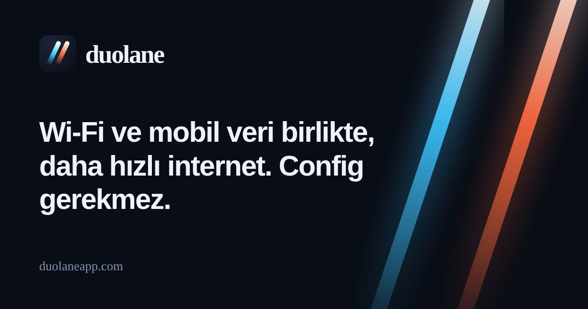
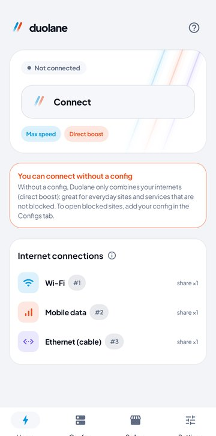
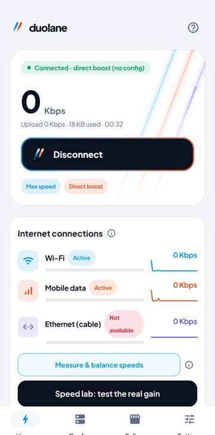
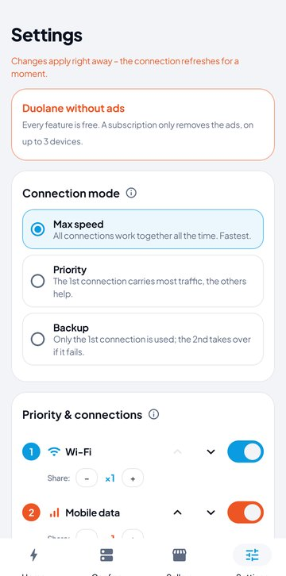
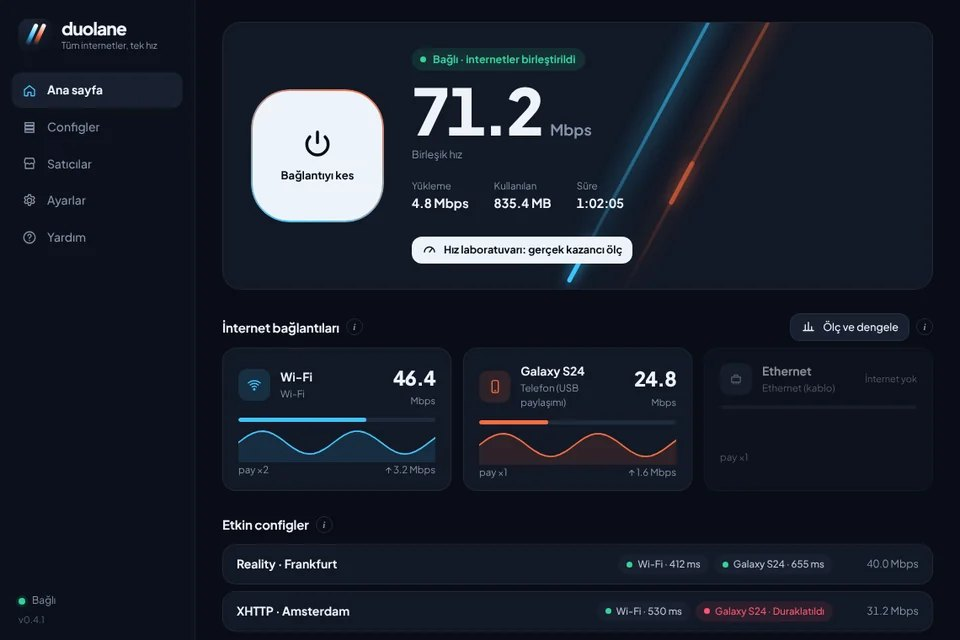

  

<h1 align="center">Duolane | Wi-Fi ve mobil veriyi birleştirerek daha hızlı internet</h1>

  <b>Wi-Fi ve mobil veriyi aynı anda kullanın: config gerekmeden daha hızlı ve daha kararlı internet.</b> 
  Android ve Windows için ücretsiz. V2Ray config'leriniz varsa tüm bağlantılarınızda birlikte çalışır.

  
  
  

  <a href="README.md">English</a> · <a href="README.fa.md">فارسی</a> · <a href="README.ar.md">العربية</a> · <b>Türkçe</b> · <a href="README.id.md">Bahasa Indonesia</a> · <a href="README.vi.md">Tiếng Việt</a>

## Duolane ne yapar?

Telefonunuz normalde aynı anda tek bir internet kullanır: ya Wi-Fi ya mobil veri, ikisi birden asla. Duolane ikisini birlikte kullanır. Her uygulama aynı anda çok sayıda bağlantı açar; Duolane bunların bir kısmını Wi-Fi'den, kalanını mobil veriden gönderir. Böylece sayfalar, indirmeler ve videolar ikisinin hızıyla yüklenir. Bağlantılardan biri kesilirse diğeri sizi çevrim içi tutar.

Windows'ta aynı şeyi bilgisayarın tüm bağlantılarıyla yapar: Wi-Fi, ağ kablosu, USB internet paylaşımıyla bağlı telefon veya ikinci bir USB Wi-Fi adaptörü.

İki kullanım şekli var:

| | Config olmadan (doğrudan hızlandırma) | V2Ray config'leriyle |
|---|---|---|
| Ne gerekir | Hiçbir şey; kurun ve Bağlan'a dokunun | VLESS, VMess, Trojan, Shadowsocks veya Hysteria2 config'i ya da abonelik bağlantısı |
| Trafik nereden gider | Hiçbir sunucudan geçmeden doğrudan internete | Config'leriniz üzerinden, tüm bağlantılara dağıtılarak |
| Ne için ideal | Daha hızlı indirme, video ve güncelleme; Wi-Fi kesilince bağlantının kopmaması | Engelli sitelere erişim; birden çok config birlikte çalışır, bozuk olan otomatik olarak devre dışı kalır |

## İndir

| Sistem | Dosya | Not |
|---|---|---|
| Android 7.0 ve üzeri | [Duolane-arm64.apk](https://github.com/duolaneapp/duolane-app/releases/latest/download/Duolane-arm64.apk) | Son 6 yılın çoğu telefonu |
| | [Duolane-universal.apk](https://github.com/duolaneapp/duolane-app/releases/latest/download/Duolane-universal.apk) | Emin değilseniz bunu seçin |
| | [Duolane-arm32.apk](https://github.com/duolaneapp/duolane-app/releases/latest/download/Duolane-arm32.apk) | Eski telefonlar |
| Windows 10 / 11 (64 bit) | [Duolane-Setup.exe](https://github.com/duolaneapp/duolane-app/releases/latest/download/Duolane-Setup.exe) | Arka plan hizmetiyle birlikte kurulum dosyası |

Tüm sürümler ve değişiklikleri [Releases sayfasında](https://github.com/duolaneapp/duolane-app/releases). Hesap veya kayıt gerekmez; güncellemeler uygulamanın içinde bildirilir.

## Ekran görüntüleri

  
  
  

## Özellikler

- **Bağlantıları birleştirme:** Android'de Wi-Fi ve mobil veri; Windows'ta Wi-Fi, kablo, USB internet paylaşımı ve USB Wi-Fi adaptörleri.
- **Üç mod:** Maksimum hız (tüm bağlantılar birlikte), Öncelik (ilk bağlantı diğerlerinin yaklaşık 3 katı trafik taşır) ve Yedek (yalnızca ana bağlantı kesilince devreye girer).
- **Aynı anda birden çok config:** Her config tüm bağlantılarda çalışır. Durumları yaklaşık dakikada bir kontrol edilir; yanıt vermeyen config birkaç dakika otomatik olarak kenara alınır.
- **Neredeyse her biçimi içe aktarır:** vless, vmess, trojan, ss ve hysteria2 bağlantıları, abonelik bağlantıları, Clash/Mihomo, sing-box ve QR kodları.
- **Dahili DNS değiştirici:** Cloudflare, Google, Quad9, AdGuard veya kendi sunucularınız; tüm uygulamalar için, config olmadan da. Sistemin şifreli DNS'i bunu atlayamaz.
- **Config olmadan siteler ve uygulamalar:** Doğrudan açılacak siteleri ve uygulamaları seçin, gerisi config'lerinizden geçsin.
- **Hız laboratuvarı:** Her bağlantıyı tek başına, sonra hepsini birlikte ölçer; kendi hattınızdaki gerçek kazancı görürsünüz.
- **Sızıntı koruması:** Bağlıyken DNS ve IPv6 tünelin dışına çıkmaz.
- **Altı dil:** Türkçe, English, العربية, Bahasa Indonesia, Tiếng Việt ve فارسی.

## Hızdan ne beklemeli?

Birleştirme hızı tam olarak iki katına çıkarmaz ve ping'i düşürmez. En büyük kazanç indirmelerde, videoda, uygulama mağazalarında ve ağır sayfalarda görülür, çünkü bunlar aynı anda çok sayıda bağlantı açar. Tarayıcıdan tek dosya indirme, sesli arama veya çevrim içi oyun tek bağlantı kullanır; daha hızlı olmaz ama bir bağlantı kesildiğinde kopmaz. Uygulamadaki hız laboratuvarı, bağlantılarınızın gerçek sonucunu gösterir.

## Başlarken

1. Duolane'i kurun; Wi-Fi ve mobil veriyi ikisini de açık tutun (Windows'ta kabloyu veya USB internet paylaşımını da bağlayın).
2. **Bağlan**'a dokunun. Doğrudan hızlandırma için bu kadar.
3. İsteğe bağlı: Bir config veya abonelik bağlantısını kopyalayın, **Configler** bölümünü açın ve **Bağlantıyı yapıştır**'a dokunun. Birlikte çalışmaları için iki ya da üç hızlı config seçin.

## Sık sorulan sorular

<b>V2Ray config'i gerekli mi?</b>

Hayır. Config olmadan Duolane bağlantılarınızı birleştirir ve trafiği doğrudan internete gönderir. Config yalnızca bulunduğunuz yerde engelli olan sitelere erişmek için gerekir.

<b>Duolane bir VPN hizmeti mi?</b>

Hayır. Duolane sunucu veya config satmaz. Trafiğinizi tüm bağlantılarınız üzerinden, config eklediyseniz kendi config'leriniz üzerinden yönlendirmek için telefonun kendi Android VPN özelliğini kullanır.

<b>Daha fazla mobil veri kullanır mı?</b>

Evet, Wi-Fi açıkken trafiğin bir kısmı mobil veriden gider. Trafiğin çoğunu Wi-Fi'de tutmak için Öncelik veya Yedek modunu kullanın.

<b>Root gerekir mi?</b>

Hayır. Android'de yalnızca standart VPN iznini ister; Windows'ta küçük bir arka plan hizmeti kurar.

<b>Ücretsiz mi?</b>

Tüm özellikler ücretsizdir. Uygulama birkaç reklam gösterir; isteğe bağlı abonelik reklamları en fazla 3 cihazda kaldırır.

## Güvenlik

- Yalnızca bu sayfadan, [duolaneapp.com](https://duolaneapp.com/tr/) adresinden veya resmi Duolane kanallarından indirin.
- Android sürümleri resmi Duolane anahtarıyla imzalanır. Android yüklü bir sürümün üzerine güncellemeyi kabul etmiyorsa, o sürüm bizden değildir.
- Windows yeni indirilen dosya için SmartScreen uyarısı gösterebilir. **Ek bilgi**'ye, ardından **Yine de çalıştır**'a tıklayın.

## Bağlantılar

- Web sitesi ve rehberler: [duolaneapp.com/tr](https://duolaneapp.com/tr/)
- Destek: [duolaneapp.com/tr/support](https://duolaneapp.com/tr/support/)
- Gizlilik: [duolaneapp.com/tr/privacy](https://duolaneapp.com/tr/privacy/)

Anahtar kelimeler: internet hızlandırma, Wi-Fi ve mobil veriyi birleştirme, çift internet, bağlantı birleştirme, daha hızlı indirme, V2Ray istemcisi, Xray, VLESS Reality, Hysteria2, abonelik, DNS değiştirici, Android, Windows, ücretsiz indir.
