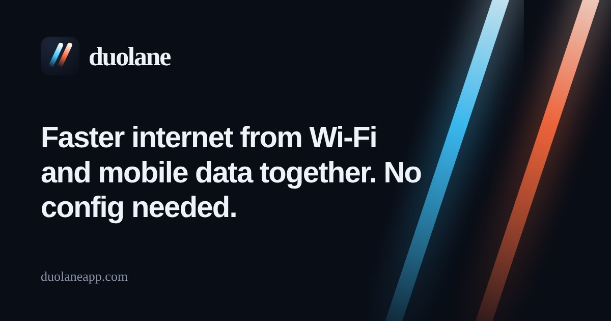
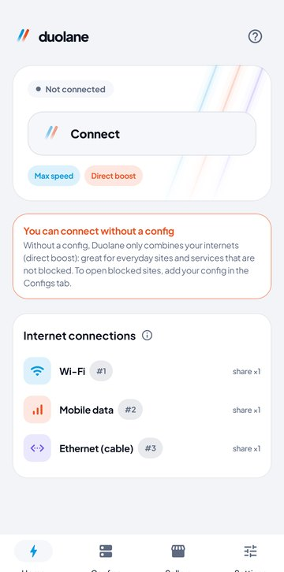
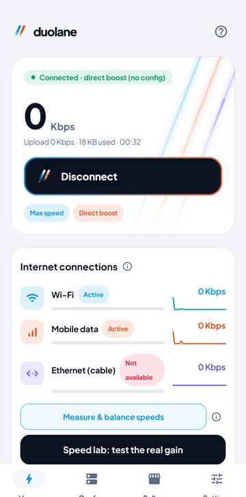
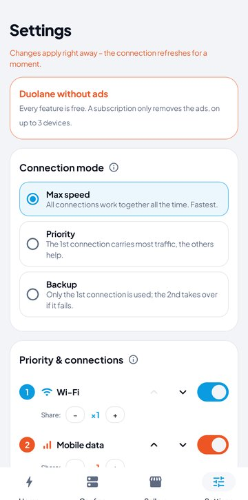
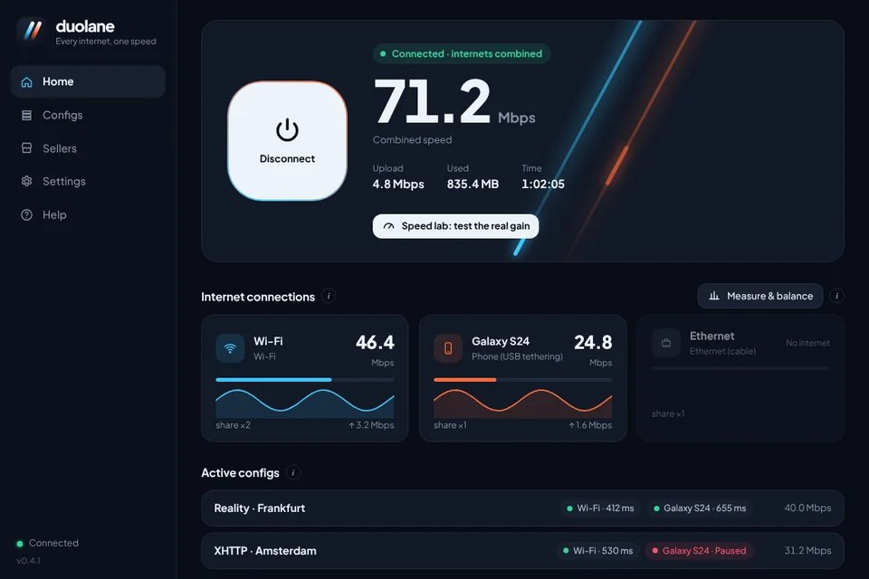

  

<h1 align="center">Duolane | Gộp Wi-Fi và dữ liệu di động cho internet nhanh hơn</h1>

  <b>Dùng Wi-Fi và dữ liệu di động cùng lúc: internet nhanh và ổn định hơn, không cần cấu hình.</b> 
  Miễn phí cho Android và Windows. Nếu bạn có cấu hình V2Ray, chúng sẽ chạy trên mọi kết nối của bạn cùng lúc.

  
  
  

  <a href="README.md">English</a> · <a href="README.fa.md">فارسی</a> · <a href="README.ar.md">العربية</a> · <a href="README.tr.md">Türkçe</a> · <a href="README.id.md">Bahasa Indonesia</a> · <b>Tiếng Việt</b>

## Duolane làm gì?

Thông thường điện thoại chỉ dùng một mạng tại một thời điểm: Wi-Fi hoặc dữ liệu di động, không bao giờ cả hai. Duolane dùng cả hai cùng lúc. Mỗi ứng dụng mở rất nhiều kết nối một lúc; Duolane gửi một phần qua Wi-Fi và phần còn lại qua dữ liệu di động, nên trang web, tệp tải về và video được tải với tốc độ của cả hai. Khi một mạng rớt, mạng còn lại vẫn giữ bạn trực tuyến.

Trên Windows, Duolane làm điều tương tự với mọi kết nối của máy tính: Wi-Fi, cáp mạng, điện thoại chia sẻ qua USB, hoặc thêm một bộ chuyển đổi Wi-Fi USB.

Có hai cách sử dụng:

| | Không cần cấu hình (tăng tốc trực tiếp) | Với cấu hình V2Ray |
|---|---|---|
| Bạn cần gì | Không cần gì; cài đặt rồi nhấn Kết nối | Cấu hình VLESS, VMess, Trojan, Shadowsocks hoặc Hysteria2, hoặc liên kết gói đăng ký |
| Lưu lượng đi đâu | Thẳng ra internet, không qua máy chủ nào | Qua các cấu hình của bạn, chia đều trên mọi kết nối |
| Phù hợp cho | Tải xuống, video và cập nhật nhanh hơn; không mất mạng khi Wi-Fi rớt | Mở các trang bị chặn, nhiều cấu hình chạy cùng lúc, cấu hình hỏng được tự động gạt ra |

## Tải về

| Hệ điều hành | Tệp | Ghi chú |
|---|---|---|
| Android 7.0 trở lên | [Duolane-arm64.apk](https://github.com/duolaneapp/duolane-app/releases/latest/download/Duolane-arm64.apk) | Hầu hết điện thoại trong 6 năm gần đây |
| | [Duolane-universal.apk](https://github.com/duolaneapp/duolane-app/releases/latest/download/Duolane-universal.apk) | Không chắc? Chọn bản này |
| | [Duolane-arm32.apk](https://github.com/duolaneapp/duolane-app/releases/latest/download/Duolane-arm32.apk) | Điện thoại cũ |
| Windows 10 / 11 (64-bit) | [Duolane-Setup.exe](https://github.com/duolaneapp/duolane-app/releases/latest/download/Duolane-Setup.exe) | Bộ cài kèm dịch vụ chạy nền |

Mọi phiên bản và thay đổi có trên [trang Releases](https://github.com/duolaneapp/duolane-app/releases). Không cần tài khoản hay đăng ký; bản cập nhật được thông báo ngay trong ứng dụng.

## Ảnh chụp màn hình

  
  
  

## Tính năng

- **Gộp các kết nối internet:** Wi-Fi và dữ liệu di động trên Android; Wi-Fi, cáp mạng, chia sẻ qua USB và bộ chuyển đổi Wi-Fi USB trên Windows.
- **Ba chế độ:** Tốc độ tối đa (mọi kết nối cùng lúc), Ưu tiên (kết nối đầu tiên gánh khoảng gấp 3 lần) và Dự phòng (chỉ chuyển khi kết nối chính bị rớt).
- **Nhiều cấu hình cùng lúc:** Mỗi cấu hình chạy trên mọi kết nối. Tình trạng được kiểm tra khoảng mỗi phút, cấu hình không phản hồi sẽ tự động bị gạt ra vài phút.
- **Nhập gần như mọi định dạng:** liên kết vless, vmess, trojan, ss, hysteria2, liên kết gói đăng ký, Clash/Mihomo, sing-box và mã QR.
- **Công cụ đổi DNS tích hợp:** Cloudflare, Google, Quad9, AdGuard hoặc máy chủ của riêng bạn, cho mọi ứng dụng, kể cả khi không có cấu hình. DNS mã hóa của hệ thống không thể đi vòng qua nó.
- **Trang và ứng dụng không qua cấu hình:** Chọn trang và ứng dụng được mở trực tiếp, phần còn lại đi qua cấu hình của bạn.
- **Phòng đo tốc độ:** Đo từng kết nối riêng rồi đo tất cả cùng lúc, để bạn thấy mức tăng thực trên đường truyền của mình.
- **Chống rò rỉ:** DNS và IPv6 luôn ở trong đường hầm khi đang kết nối.
- **Sáu ngôn ngữ:** Tiếng Việt, English, العربية, Türkçe, Bahasa Indonesia và فارسی.

## Nên kỳ vọng tốc độ thế nào?

Gộp mạng không làm tốc độ tăng đúng gấp đôi và không làm giảm ping. Mức tăng rõ nhất là ở tải xuống, video, kho ứng dụng và các trang nặng, vì chúng mở nhiều kết nối cùng lúc. Một lượt tải bằng trình duyệt, cuộc gọi thoại hay trò chơi trực tuyến chỉ dùng một kết nối, nên không nhanh hơn, nhưng không bị ngắt khi một mạng rớt. Phòng đo tốc độ trong ứng dụng cho bạn con số thực của các kết nối.

## Bắt đầu

1. Cài Duolane, bật cả Wi-Fi và dữ liệu di động (trên Windows, cắm thêm cáp mạng hoặc chia sẻ qua USB).
2. Nhấn **Kết nối**. Vậy là xong với tăng tốc trực tiếp.
3. Tùy chọn: sao chép liên kết cấu hình hoặc gói đăng ký, mở **Cấu hình** rồi nhấn **Dán liên kết**. Chọn hai hoặc ba cấu hình nhanh để chạy cùng nhau.

## Câu hỏi thường gặp

<b>Tôi có cần cấu hình V2Ray không?</b>

Không. Khi không có cấu hình, Duolane gộp các kết nối và gửi lưu lượng thẳng ra internet. Bạn chỉ cần cấu hình để mở các trang bị chặn ở nơi bạn sống.

<b>Duolane có phải dịch vụ VPN không?</b>

Không. Duolane không bán máy chủ hay cấu hình. Ứng dụng dùng tính năng VPN có sẵn của Android ngay trên điện thoại để định tuyến lưu lượng qua mọi kết nối của bạn, và qua cấu hình của chính bạn nếu bạn thêm vào.

<b>Có tốn thêm dữ liệu di động không?</b>

Có, khi Wi-Fi đang bật thì một phần lưu lượng đi qua dữ liệu di động. Dùng chế độ Ưu tiên hoặc Dự phòng để giữ phần lớn lưu lượng trên Wi-Fi.

<b>Có cần root không?</b>

Không. Trên Android chỉ cần quyền VPN thông thường; trên Windows ứng dụng cài một dịch vụ chạy nền nhỏ.

<b>Có miễn phí không?</b>

Mọi tính năng đều miễn phí. Ứng dụng có hiển thị một ít quảng cáo; gói đăng ký tùy chọn gỡ quảng cáo trên tối đa 3 thiết bị.

## An toàn

- Chỉ tải từ trang này, từ [duolaneapp.com](https://duolaneapp.com) hoặc từ các kênh chính thức của Duolane.
- Bản Android được ký bằng khóa chính thức của Duolane. Nếu Android từ chối cài bản cập nhật đè lên bản đã cài, bản đó không phải do chúng tôi phát hành.
- Windows có thể hiện cảnh báo SmartScreen cho tệp mới tải. Chọn **More info**, rồi **Run anyway**.

## Liên kết

- Trang web và hướng dẫn: [duolaneapp.com](https://duolaneapp.com)
- Hỗ trợ: [duolaneapp.com/support](https://duolaneapp.com/support/)
- Quyền riêng tư: [duolaneapp.com/privacy](https://duolaneapp.com/privacy/)

Từ khóa: tăng tốc internet, gộp Wi-Fi và 4G, dùng Wi-Fi và dữ liệu di động cùng lúc, tải nhanh hơn, ứng dụng V2Ray, Xray, VLESS Reality, Hysteria2, gói đăng ký, đổi DNS, Android, Windows, miễn phí.
